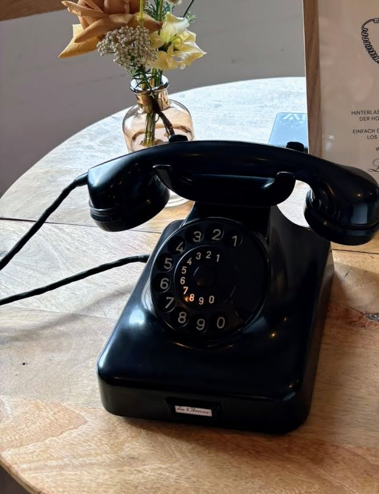
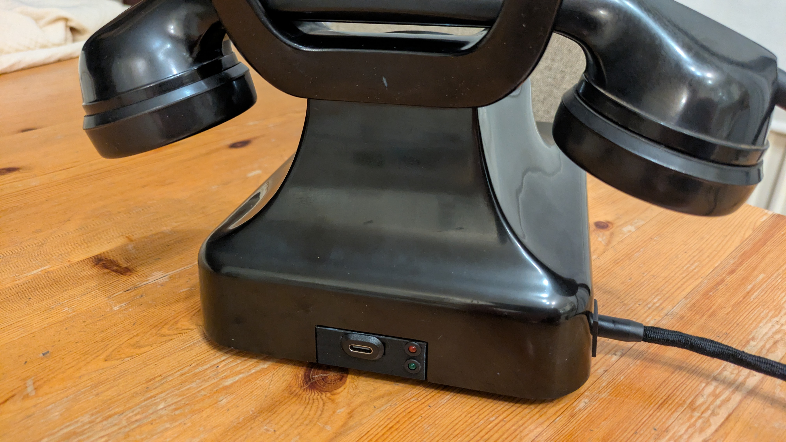
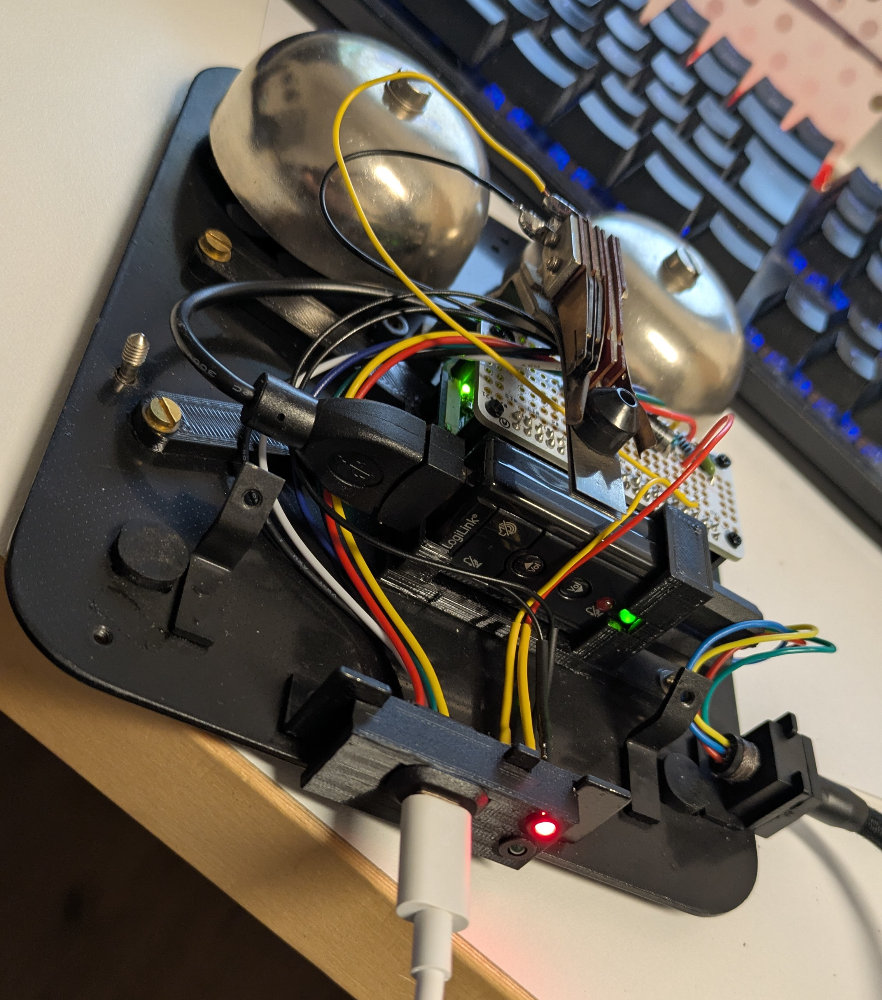
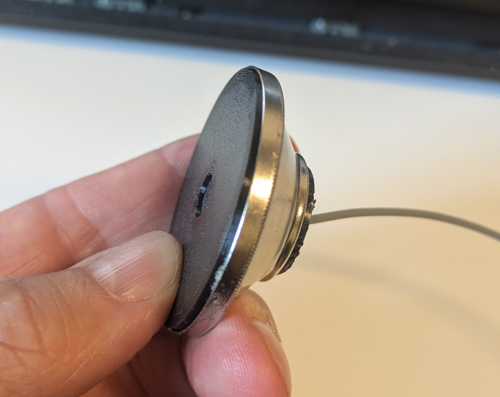

# grueslesbox-w48

An interactive audio guestbook and jukebox project built into a vintage W48 Bakelite telephone (1950s). Powered by a Raspberry Pi Zero, custom audio hardware, Python state machine logic, and custom 3D-printed PETG mounts.



## Gallery / Visuals

<table>
  <tr>
    <td align="center" width="33%"><a href="assets/images/grueslesbox-w48.jpg"></a><br><b>Grueslesbox W48</b></td>
    <td align="center" width="33%"><a href="assets/images/grueslesbox-w48-part-assembled.jpg"></a><br><b>Partially Assembled</b></td>
    <td align="center" width="33%"><a href="assets/images/grueslesbox-w48-usb-c.jpg"></a><br><b>USB-C Integration</b></td>
  </tr>
  <tr>
    <td align="center" width="33%"><a href="assets/images/grueslesbox-w48-wo-case.jpg"></a><br><b>Internals</b></td>
    <td align="center" width="33%"><a href="assets/images/mce401_mic_mount.jpg"></a><br><b>MCE-401 Mic Mount</b></td>
    <td align="center" width="33%"></td>
  </tr>
</table>

## Features

- **Dual-Mode Operation:** 
  - **Record Mode (`record`):** Functions as a classic audio guestbook. Lifting the handset plays a welcome greeting (`greeting.wav`), followed by a beep (`beep.wav`), and then records the guest's message via the built-in electret microphone.
  - **Jukebox Mode (`playback`):** Acts as an interactive playback device. Lifting the handset continuously loops through all recorded guest messages, separated by a beep tone between tracks, allowing you to listen to all messages over and over again.
- **Hardware Hook Integration:** Direct control via the original mechanical hook switch using Raspberry Pi GPIO pins.
- **Automated State Persistence:** Automatically tracks the current playback index (`playback_state.json`) for seamless continuous listening across sessions.

## Hardware & Components

- **Telephone:** Original W48 Bakelite telephone.
- **Microphone:** MCE-401 electret microphone capsule with a custom 3D-printed mount.
- **Controller:** Raspberry Pi Zero.
- **Audio Interface:** LogiLink UA0078 USB audio adapter.
- **Power / USB-C Integration:** Custom USB-C port integration for power delivery, built with insights from this [USB-C Introduction for Hackers](https://hackaday.com/2022/12/06/usb-c-introduction-for-hackers/) article.
- **Enclosure / Mounts:** Custom 3D-printed structural components (PETG).

## 3D Models & CAD Assets

The [assets/3d_models/](assets/3d_models/) directory contains all custom-designed parts for 3D printing and modification:
- **`w48_raspberry_pi_mount`:** Custom bracket for securing the Raspberry Pi inside the W48 shell ([.f3d](assets/3d_models/w48_raspberry_pi_mount.f3d), [.3mf](assets/3d_models/w48_raspberry_pi_mount.3mf)).
- **`mce401_mic_mount`:** Specific capsule holder for the MCE-401 microphone ([.f3d](assets/3d_models/mce401_mic_mount.f3d), [.3mf](assets/3d_models/mce401_mic_mount.3mf)).
- **`w48_usb_c`:** Custom mount/adapter elements ([.f3d](assets/3d_models/W48-usb-c.f3d), [.3mf](assets/3d_models/W48-usb-c.3mf)).

## Audio Setup & Troubleshooting Tips

When retrofitting vintage telephones with modern USB audio adapters and a Raspberry Pi, ground loops and power line interference can introduce unwanted hum or noise into recordings. To prevent this, you can use a floating power source (such as an ungrounded USB Power Bank) or implement one of the following hardware solutions:

### Option 1: USB Isolator (The Plug & Play Solution)
- **Cost:** Approx. 10 to 15 Euros (e.g., models using the ADuM3160 chip).
- **Space Requirements & Space-Saving Trick:** Out of the box, a standard USB isolator with cables and the LogiLink stick can be quite bulky for the W48 shell. However, by removing the plastic enclosures of both the USB isolator and the LogiLink stick, you are left with two tiny circuit boards. Solder them directly together using short wires (`GND`, `5V`, `D+`, `D-`) and wrap them in transparent heat-shrink tubing. This allows you to mount the setup extremely compactly inside the phone.

### Option 2: Audio Transformer with Bias Circuit (The Compact Electronics Solution)
- **Cost:** Very affordable, under 10 Euros. A ready-made "Ground Loop Isolator" (with audio jacks) costs approx. 8 Euros, while bare 1:1 audio transformers (600 Ohm) cost only 1 to 3 Euros each (plus cent-priced resistors and capacitors).
- **Space Requirements:** Minimal. Stripping a Ground Loop Isolator of its plastic case reveals two tiny transformers (about the size of a sugar cube). Combined with a tiny stripboard (e.g., 2x2 cm), the complete circuit easily fits somewhere next to the W48 cradle mechanism.
- **Circuit Design & Bias Setup:** Since transformers block DC voltage, the MCE-401 capsule requires an independent power supply (bias circuit):
  1. Tap 3.3V from the Raspberry Pi Zero (Pin 1 or 17).
  2. Connect a pull-up/series resistor (approx. 2.2 kOhm to 4.7 kOhm) from the 3.3V line to the positive terminal of the microphone capsule.
  3. Connect the Pi's ground (`GND`) to the negative terminal of the capsule.
  4. Route the audio signal from the capsule's positive terminal through a coupling capacitor (e.g., 10 µF, positive side facing the capsule) into the primary side of the audio transformer (this filters out the DC voltage).
  5. Connect the secondary side of the transformer directly to the microphone input of the LogiLink adapter.

## Project Structure

- `~/grueslesbox-w48/`
  - `audio/` - Audio files (`greeting.wav`, `beep.wav`)
  - `recordings/` - Recorded guest messages (`.wav`)
  - `src/` - Python controller scripts
  - [`assets/`](assets/) - Documentation, schematics, and 3D models
    - [`images/`](assets/images/) - Photos of the build and hardware
    - [`3d_models/`](assets/3d_models/) - STL, 3MF, and Fusion 360 files
  - `config.json` - Mode configuration (`record` / `playback`)
  - `playback_state.json` - Persistent tracking for jukebox playback
  - `README.md`

## Configuration (`config.json`)

The operating mode of the phone can be configured via the `config.json` file in the root directory by setting the `mode` key to either `record` or `playback`:

```json
{
  "_comment": "Accepted values for 'mode': 'record' (recording mode) or 'playback' (jukebox playback mode)",
  "mode": "record"
}
```

## License

- **Software / Code:** 
  Licensed under the **Apache License 2.0**. You may use, modify, and distribute the code under the terms of this license.
- **Hardware & 3D Models (`assets/`):** 
  Licensed under the **Creative Commons Attribution-NonCommercial-ShareAlike 4.0 International License (CC BY-NC-SA 4.0)**. This applies to all 3D models (`.f3d`, `.stl`, `.3mf`), schematics, and images located in the `assets/` directory.